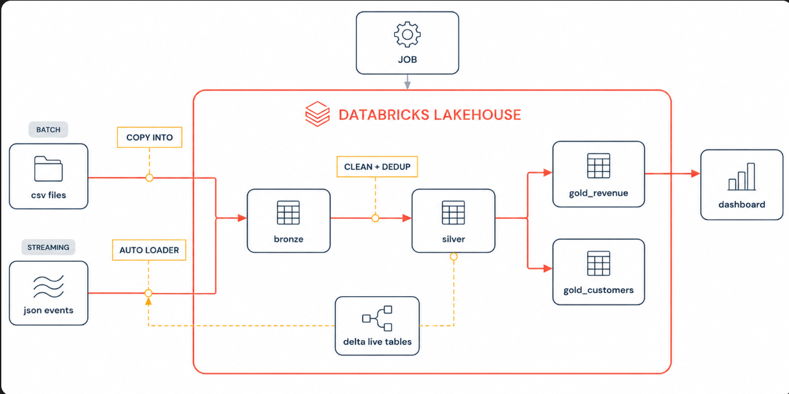

# ShopStream: Databricks Lakehouse Pipeline

An end-to-end data pipeline on the Databricks Lakehouse that ingests **batch CSV files** and **streaming JSON events**, refines them through a **medallion architecture** (bronze → silver → gold), and serves business metrics through a **Databricks SQL dashboard**.



## Overview

ShopStream is a simulated e-commerce platform. Orders and customers arrive as batch CSV files, while order events arrive continuously as JSON. The pipeline loads both into Delta tables, cleans and deduplicates the data, and produces gold-layer aggregates for revenue and customer analytics.

## Architecture

| Layer | Source / Input | Tooling | Output |
|-------|----------------|---------|--------|
| **Bronze** (batch) | CSV files | `COPY INTO` | `bronze_orders`, `bronze_customers` |
| **Bronze** (streaming) | JSON events | Auto Loader (`cloudFiles`) | `pipe_events_bronze` |
| **Silver** | Bronze tables | SQL, `QUALIFY ROW_NUMBER()` dedup | `silver_orders`, `silver_customers` |
| **Gold** | Silver tables | SQL / Delta Live Tables | `gold_revenue`, `gold_customers`, `pipe_daily_revenue` |
| **Serving** | Gold tables | Databricks SQL | Dashboard |
| **Orchestration** | All of the above | Databricks Jobs (Workflows) | Scheduled end-to-end run |

## Tech Stack

- Databricks (Lakehouse, Unity Catalog, Databricks SQL, Workflows)
- Delta Lake
- Delta Live Tables (Lakeflow Declarative Pipelines)
- Auto Loader
- PySpark and SQL

## Data Quality Handling

Issues found in the raw data and how the silver layer handles them:

- **Duplicate order lines:** the same `order_line_id` appearing more than once. Resolved by keeping the latest record per `order_line_id` with `ROW_NUMBER()` and `QUALIFY`.
- **Invalid quantities:** rows with `quantity <= 0` are filtered out.
- **Placeholder values:** `'N/A'` coupon codes are converted to `NULL` with `NULLIF`.
- **Inconsistent text:** whitespace trimmed and emails/status values lower-cased.

Example (silver orders):

```sql
CREATE OR REPLACE TABLE shopstream.core.silver_orders AS
WITH dedup AS (
    SELECT *
    FROM shopstream.core.bronze_orders
    QUALIFY ROW_NUMBER() OVER (PARTITION BY order_line_id ORDER BY order_ts DESC) = 1
)
SELECT
    order_line_id,
    order_id,
    customer_id,
    product_id,
    quantity,
    unit_price,
    ROUND(quantity * unit_price, 2) AS line_revenue,
    order_ts,
    LOWER(status) AS status,
    NULLIF(coupon_code, 'N/A') AS coupon_code
FROM dedup
WHERE quantity > 0;
```

## Repository Structure

```
shopstream-lakehouse/
├── README.md
├── docs/
│   ├── architecture.png
│   └── dashboard.png
├── data/
│   └── sample/                  # small sample CSV / JSON files
├── notebooks/
│   ├── 00_setup.sql             # catalog, schema, volumes
│   ├── 01_bronze_batch.sql      # COPY INTO
│   ├── 02_bronze_streaming.py   # Auto Loader
│   ├── 03_silver_orders.sql
│   ├── 04_silver_customers.sql
│   ├── 05_gold_revenue.sql
│   └── 06_gold_customers.sql
├── pipelines/
│   └── dlt_pipeline.py          # Delta Live Tables definitions
├── jobs/
│   └── shopstream_job.json      # exported Workflow definition
├── sql/
│   ├── data_quality_checks.sql
│   └── dashboard_queries.sql
└── scripts/
    └── generate_sample_data.py
```

## Getting Started

1. **Create a Databricks workspace** with Unity Catalog enabled (Free Edition works for most of this).
2. **Clone this repo** into Databricks Repos or import the notebooks.
3. **Run `00_setup.sql`** to create the `shopstream` catalog, the `core` schema, and landing volumes.
4. **Generate or upload sample data** to the landing volume (`scripts/generate_sample_data.py`).
5. **Run the notebooks in order** (01 → 06), or create the Job from `jobs/shopstream_job.json`.
6. **Create the DLT pipeline** pointing at `pipelines/dlt_pipeline.py`.
7. **Build the dashboard** using the queries in `sql/dashboard_queries.sql`.

## Dashboard


Key views: daily revenue, revenue by product/region, customer order counts and lifetime value.

## Key Learnings

- Idempotent batch ingestion with `COPY INTO` vs. incremental streaming ingestion with Auto Loader
- Deduplication patterns using window functions and `QUALIFY`
- Declarative pipelines with Delta Live Tables and data quality expectations
- Orchestrating dependent tasks with Databricks Jobs

## Future Improvements

- Add DLT expectations (`@dlt.expect`) for automated data quality enforcement
- Add CI checks and automated tests for transformation logic
- Incremental (`MERGE`) loads into silver instead of full rebuilds

## Author

**Sohom**
[LinkedIn](https://www.linkedin.com/) · [GitHub](https://github.com/)
